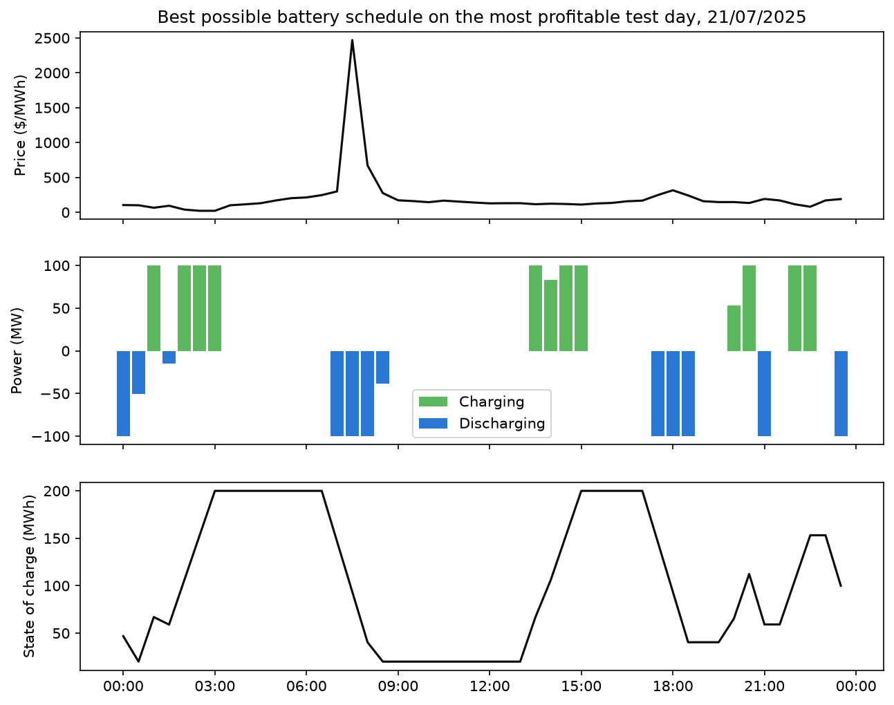
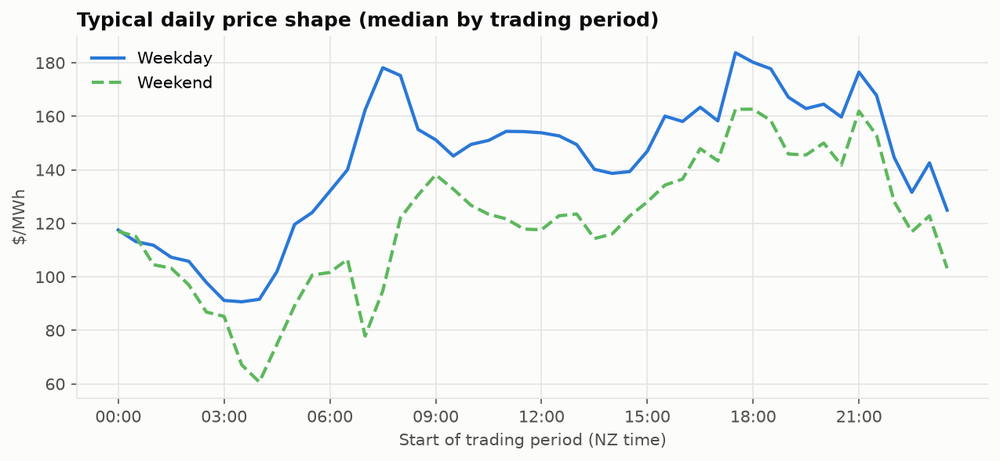
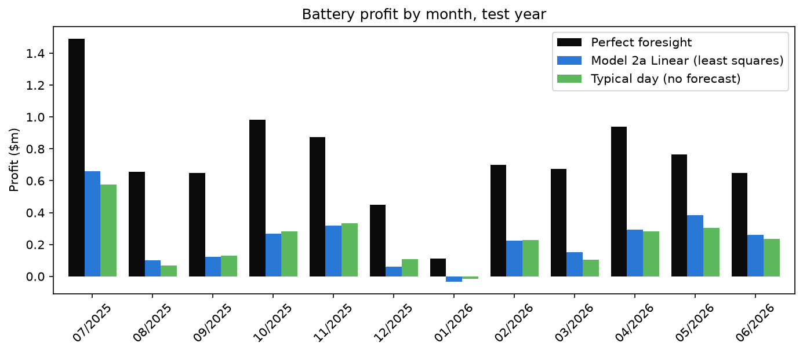

# NZ Electricity Price Forecasting and Battery Arbitrage

## The main question:
**How much could a grid-scale battery in Auckland (Mt Roskill) earn by buying cheap and selling dear, and how much of that does it keep when it relies on a price forecast instead of knowing the future?**

A hypothetical 100 MW / 200 MWh battery (matching the spec of Contact Energy's Glenbrook battery) at the Mt Roskill grid node, scheduled every day of a full year with a linear program, using day-ahead price forecasts from five models.

## Headline results
- **Forecast-driven scheduling captured 31% of the profit possible with perfect foresight** (\$2.81m of \$8.94m over a 353-day test year).
- **The most accurate forecast was not the most profitable.** LightGBM had the lowest error (MAE \$30.22/MWh, 17% below a naive forecast) but earned the least of the trained models. Profit followed how well a model **ranked** each day's prices, not how close it got to their level.
- **Forecasting matters most when cycling is costly.** For the base battery, the best forecast only slightly beat a no-forecast "typical day" schedule (31.4% vs 29.5% capture). At a \$20/MWh degradation cost it earned 59% more.



## Data
| Source | What | Period |
|---|---|---|
| Electricity Authority (EMI) | Half-hourly final wholesale prices, Mt Roskill 110 kV node (`ROS1101`) | Jan 2023 to Jun 2026 |
| Open-Meteo Historical Weather API | Hourly Auckland temperature and Manawatū wind speed (100 m) | Jan 2023 to Jun 2026 |
| Open-Meteo Previous Runs API | Archived day-ahead forecasts of the same weather | Jan 2024 to Jun 2026 |

60,912 half-hourly periods after cleaning. The 7 daylight-saving change days and 31/12/2025 (missing from EMI) were dropped.



## Method

### 1. Forecasting
Each model forecasts all 48 trading periods of day D using only information available by the end of day D-1.

| Model | How it forecasts |
|---|---|
| Naive | Yesterday's price, same period |
| Weekly naive | Last week's price, same period |
| Linear (least squares) | Linear regression on price lags, calendar and weather features |
| Linear (absolute error) | The same model fitted by minimising absolute error (median regression, solved as an LP) |
| LightGBM | Gradient-boosted trees, absolute-error loss |

- **Walk-forward validation:** each month, models are retrained on all earlier data and then predict that month, so no model ever trains on the future.
- **Validation year** (Jul 2024 to Jun 2025) for comparing and tuning models. **Test year** (Jul 2025 to Jun 2026) used once, at the end.
- **Realistic weather:** models train on actual weather but predict with day-ahead weather **forecasts**, as they would in practice. This cost no accuracy (MAE \$54.46 vs \$54.66 on validation), while dropping weather entirely cost \$3.66/MWh.

### 2. Battery optimisation
For each day, a linear program chooses charging and discharging power in every half-hour to maximise profit:

- **Maximise** revenue from discharging minus the cost of charging minus a \$5/MWh degradation cost
- **Subject to** the energy balance in every period (with 94% charging and 94% discharging efficiency), power limits of 100 MW, a state of charge between 20 and 200 MWh, and ending each day at the same charge it started with (100 MWh)

144 variables and 49 constraints per day, solved with SciPy's HiGHS solver in about 2 ms.

### 3. Backtest
Each strategy plans the day with its forecast, then is paid at the **actual** prices.
- **Perfect foresight** plans with the actual prices (the upper bound).
- **Typical day** plans with the median price of each period over all pre-test data (no forecast at all).

**Capture rate** = strategy profit ÷ perfect-foresight profit × 100%.

## Results

### Forecast accuracy (test year)
| Model | MAE (\$/MWh) | RMSE (\$/MWh) | Ranking (Spearman) |
|---|---|---|---|
| LightGBM | **30.22** | **51.56** | 0.49 |
| Linear (absolute error) | 31.75 | **51.56** | **0.52** |
| Linear (least squares) | 35.39 | 53.40 | 0.51 |
| Naive | 36.48 | 66.97 | 0.38 |
| Weekly naive | 48.94 | 80.24 | 0.34 |

### Battery profit (test year, 353 days)
| Strategy | Profit | Capture rate |
|---|---|---|
| Perfect foresight | \$8.94m | 100% |
| Linear (least squares) | \$2.81m | 31.4% |
| Linear (absolute error) | \$2.80m | 31.3% |
| LightGBM | \$2.68m | 29.9% |
| Typical day (no forecast) | \$2.63m | 29.5% |
| Weekly naive | \$0.73m | 8.2% |
| Naive | \$0.70m | 7.9% |



### Key findings
1. **Ranking beats accuracy for battery scheduling.** The model with the lowest MAE earned the least of the trained models. The linear models, which ranked each day's prices best, earned the most.
2. **About 70% of perfect-foresight profit is out of reach** for any day-ahead forecast. It comes from unpredictable spikes, such as \$2,500/MWh on 21/07/2025.
3. **Tree models fail in unprecedented conditions.** On the validation year LightGBM lost to the linear models, and about 85 to 90% of the gap came from the August 2024 price crisis, when prices exceeded anything in its training data. On the calmer test year it had the lowest error.
4. **Naive forecasts lose money on 43% of days.** When yesterday's prices were flat, the naive plan's timing was arbitrary. On 23/10/2025 it charged straight into an \$850/MWh spike, losing \$54k while perfect foresight earned \$104k.
5. **Forecasting is worth more when cycling is costly or lossy.** At 80% round-trip efficiency, the typical-day schedule's capture fell to 16.9% while the linear model held 25.3%.
6. **Bigger batteries earn more, with diminishing returns:** perfect-foresight profit per MWh of capacity falls from \$60k (1 hour) to \$45k (2 hours) to \$30k (4 hours).

## Limitations
- **Price-taker assumption:** the battery's own trading is assumed not to move prices. Real batteries of this size can affect local prices.
- **Hypothetical battery and location:** no battery exists at Mt Roskill. Mt Roskill prices differ from Otahuhu's by \$0.35/MWh on average, so results are broadly representative of Auckland.
- **Energy arbitrage only:** real batteries also earn from reserves and other services, which are not modelled.
- **Each day is optimised independently**, starting and ending at 100 MWh, so the battery cannot carry charge overnight into a high-price day.

## How to run
Python 3.14. Install the dependencies, then run the scripts in order from the repo root:

```bash
pip install -r requirements.txt
python src/download_prices.py
python src/download_weather.py
python src/download_weather_forecasts.py
python src/build_dataset.py
python src/features.py
```

Then run the notebooks in order (`01` to `06`).


## Author
Dev Tiwari, Engineering Science, University of Auckland